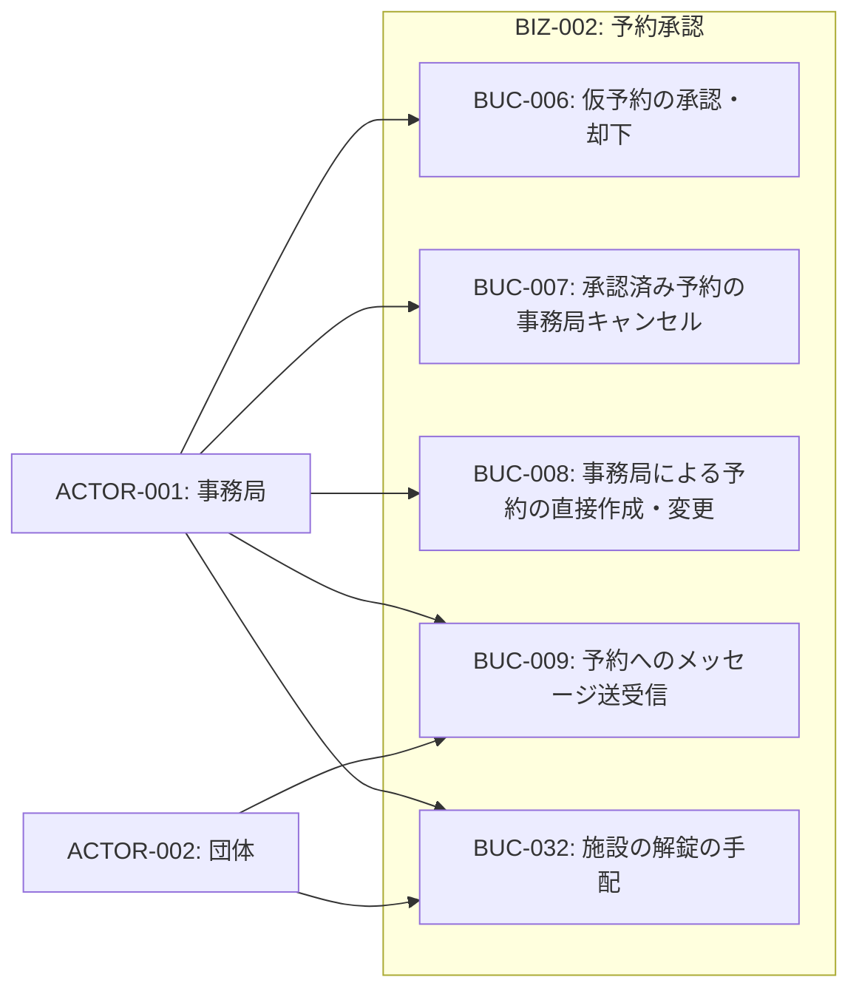
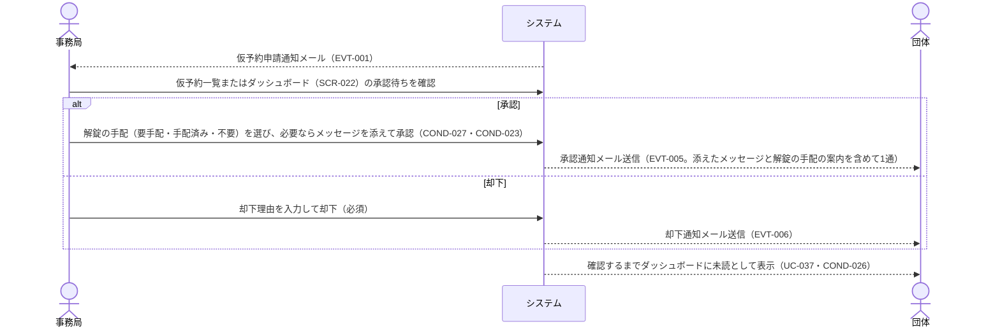
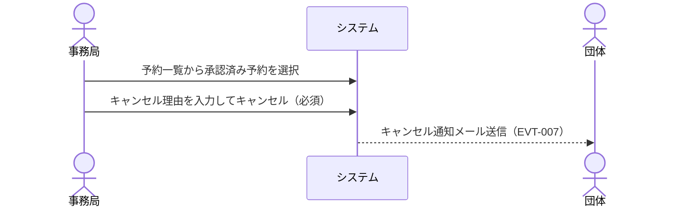
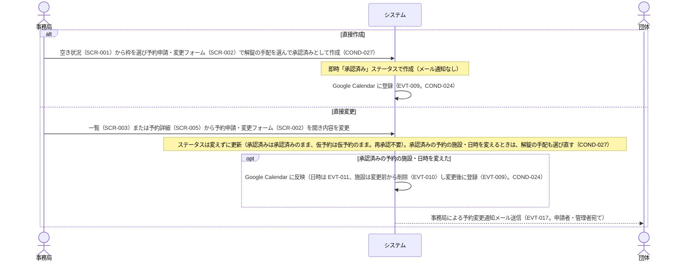
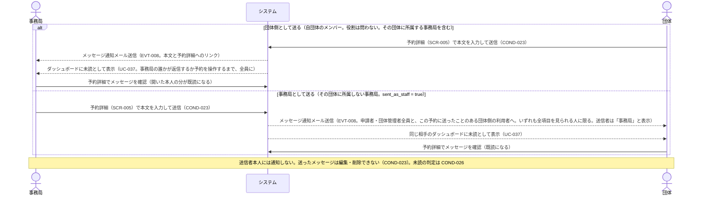
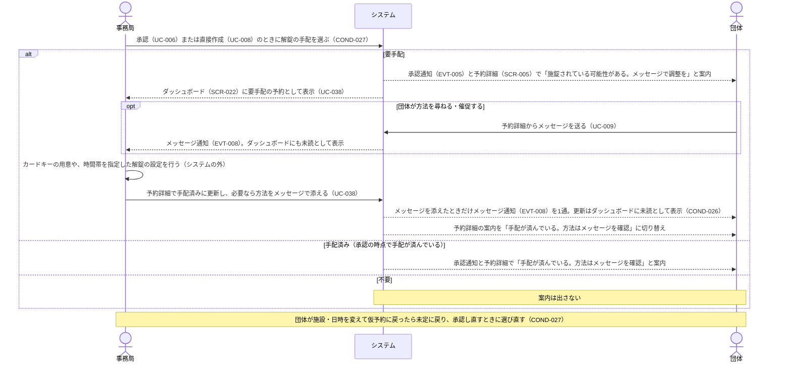

# BIZ-002: 予約承認

事務局による仮予約の承認・却下、直接予約の作成・変更、メッセージ送受信、施設の解錠の手配を担うコンテキスト。

事務局の権限は団体内ロール（VAR-001）とは別の軸にあり、団体への所属に関わらず全団体・全予約に及ぶ（COND-009）。判定の根拠は INFO-006.is_staff である。

事務局は予約を削除できない。取りやめる場合は事務局キャンセルまたは却下で、理由とともに記録を残す。削除すると予約詳細ごと消え、団体が「いつ・なぜ無くなったか」を確かめられなくなるためである（GOAL-007）。事務局による承認・却下・キャンセル・直接作成・直接変更・解錠の手配の更新は操作履歴（BIZ-007）に記録され、事務局権限によって初めて許された操作は団体側に「事務局」と表示される（COND-012）。メッセージの送信（UC-009）は操作履歴の対象外である（メッセージ自体に送信者と日時が残る）。そのため、送ったメッセージは編集も削除もできない（COND-023）。

相手方の動き（メッセージ・承認・却下・キャンセルなど）は、メールで知らせる（EVT-005〜008・EVT-017）ほか、確認するまでダッシュボードに未読として出す（UC-037・COND-026）。出すのは「まだ見ていないこと」であり、「返信が要ること」ではない。返信待ちを状態として持つと、やり取りを終えた後も、最後に受け取った側にずっと残り続けるためである。やり取りの単位は予約そのものとし、要件ごとのスレッドや、スレッドを閉じる操作は設けない。予約が終われば、やり取りも自然に終わる。

施設の解錠の手配が要るかは、事務局が承認のときに予約ごとに判断して記録する（REQ-047・COND-027）。土日・祝日や平日の夜など、建物の玄関が施錠される日時の規則はシステムに持たせない。規則は大学が決めるもので例外も多く、持たせても取りこぼしを防げないためである。その代わり、どの予約も必ず通る承認の時点で事務局に選ばせ、既定値は置かない。解錠の方法（カードキーの貸し出し、時間帯を指定した解錠の設定など）は予約ごとに違うため、状態としては持たずメッセージで伝える。承認と同時にメッセージを送れるようにし（REQ-048）、通知は承認のメール1通にまとめる。

## ビジネスコンテキスト図

## 業務フロー

### BUC-006: 仮予約の承認・却下

### BUC-007: 承認済み予約の事務局キャンセル

### BUC-008: 事務局による予約の直接作成・変更

### BUC-009: 予約へのメッセージ送受信

### BUC-032: 施設の解錠の手配

